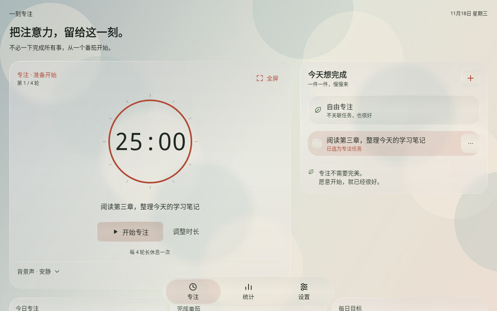
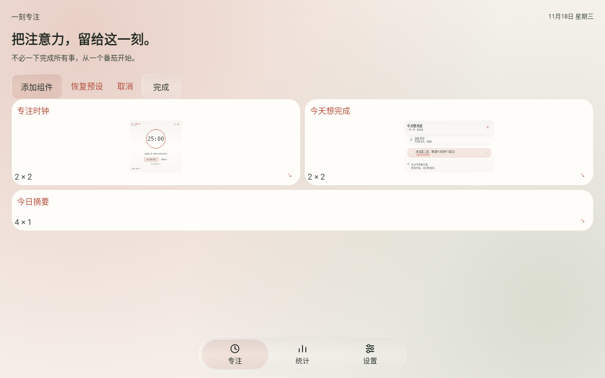
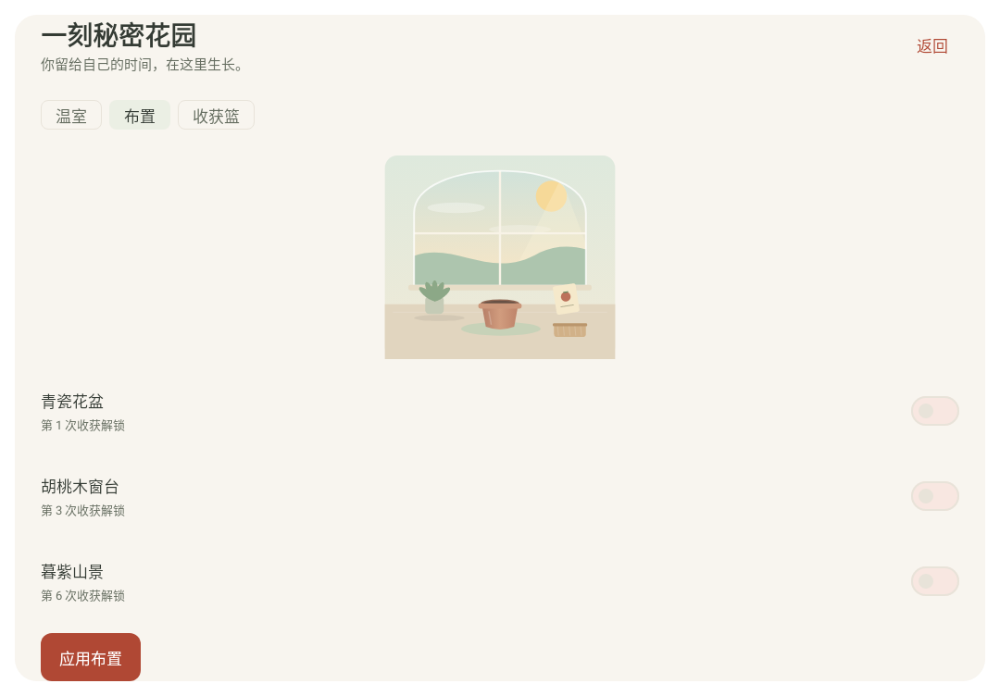
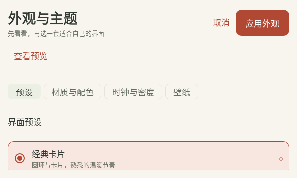

# 一刻专注 · Yike Focus

一款为 Android 平板设计的液态玻璃番茄钟。上下滚动时，壁纸的颜色透过任务卡片和统计面板。手指划过悬浮导航，选中胶囊的圆角边缘会折射下方的内容，文字和时钟依然清晰。

**[下载安卓版 2.4.0](https://github.com/PinkPurpleYellow/yike-focus/releases/download/v2.4.0/yike-focus-2.4.0.apk)**　·　[更新记录](app/src/main/assets/changelog.txt)　·　[隐私政策全文](app/src/main/assets/privacy_policy.txt)

*2.4.0 应用界面，使用项目绘制的渐变壁纸进行主机渲染。*

在「设置 → 外观与布局」选择「液态玻璃」，可以调整透明度和模糊强度。Android 13 及以上支持动态着色器折射，Android 12/12L 支持实时模糊，Android 8–11 使用兼容磨砂效果。喜欢安静的界面时，可以关闭装饰动效，或切回传统卡片。

专注计时、任务清单和七天统计都能离线使用。开始一轮专注，打开全屏时钟，或为自己选一段雨声。

## 安装与升级

支持 Android 8.0 及以上。用平板下载安装包，打开后按系统提示安装。首次使用时可以先阅读用户协议和隐私政策。已有旧版的用户请先完成当前专注，按需在设置里导出备份，再打开新版 APK 选择更新。

## 3.0.0 · 布置自己的专注桌面

长按页面留白或点「编辑布局」，将专注时钟、任务、背景声和统计卡片排成顺手的样子。拖动卡片调整顺序，拖右下角改变宽高，点「完成」保存。两页分别记住你的布局。

统计页可以添加近四周热力图和任务用时排行。发现花房后，可以把它放在桌面上。累计收获会解锁青瓷花盆、胡桃木窗台与暮紫山景。

设置按分类浏览。「外观与布局」中的预设、材质、时钟和壁纸都有自己的选项，顶部可随时应用或取消。

## 从源码构建

安装 JDK 17、Android SDK Platform 35、Build Tools 35.0.0，配置 Android SDK 路径。用 Android Studio 打开仓库，或在根目录运行 Gradle Wrapper。Windows 用 `gradlew.bat :app:assembleDebug`，macOS 或 Linux 用 `bash gradlew :app:assembleDebug`。构建完成后，调试包位于 `app/build/outputs/apk/debug/`。

## 版权与联系

开发者 **PinkPurpleYellow** · ff1921570609@outlook.com。自有代码的权利声明及第三方许可见[版权说明](COPYRIGHT.md)。
