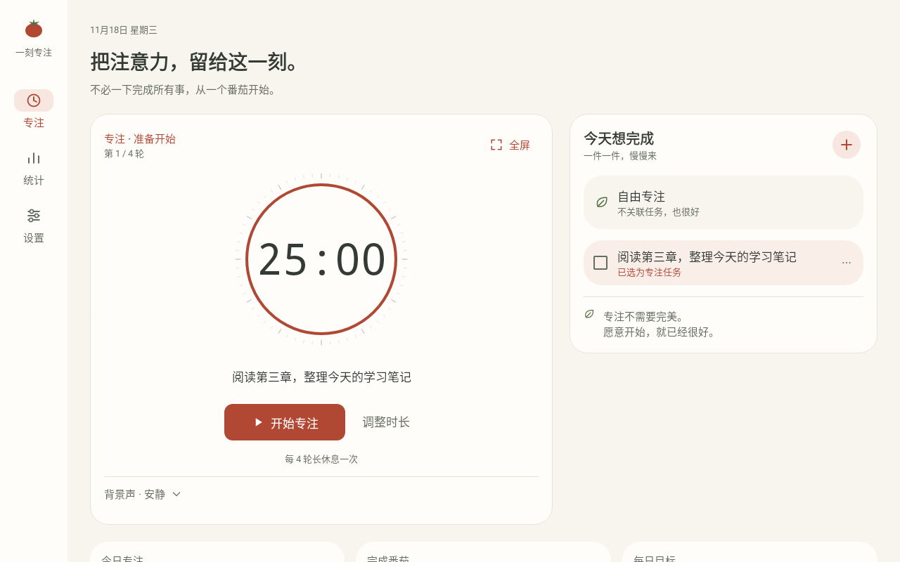

# 一刻专注 · Yike Focus

在安卓平板上安排专注和休息，记录今天想完成的任务。这款离线番茄钟支持全屏时钟、六种背景声、七天统计和自定义壁纸。

**[下载安卓版 2.4.0](https://github.com/PinkPurpleYellow/yike-focus/releases/download/v2.4.0/yike-focus-2.4.0.apk)**　·　[查看版本说明](https://github.com/PinkPurpleYellow/yike-focus/releases/tag/v2.4.0)　·　[隐私政策](https://pinkpurpleyellow.github.io/yike-focus/privacy-policy.html)

## 安装与升级

支持 Android 8.0 及以上。用平板下载安装包，打开后按系统提示安装。首次使用时可以先阅读用户协议和隐私政策。已有旧版的用户请先完成当前专注，按需在设置里导出备份，再打开新版 APK 选择更新。

## 本版亮点

- 卡片与悬浮导航使用液态玻璃材质，文字和统计图保持清晰。
- 首次使用时可离线阅读协议；日后也能在「设置 → 关于」查看。
- 历史更新按版本整理。详见[更新日志](app/src/main/assets/changelog.txt)。

## 从源码构建

安装 JDK 17、Android SDK Platform 35、Build Tools 35.0.0，配置 Android SDK 路径。用 Android Studio 打开仓库，或在根目录运行 Gradle Wrapper。Windows 用 `gradlew.bat :app:assembleDebug`，macOS 或 Linux 用 `bash gradlew :app:assembleDebug`。构建完成后，调试包位于 `app/build/outputs/apk/debug/`。

## 版权与联系

开发者 **PinkPurpleYellow** · ff1921570609@outlook.com。自有代码的权利声明及第三方许可见[版权说明](COPYRIGHT.md)。
